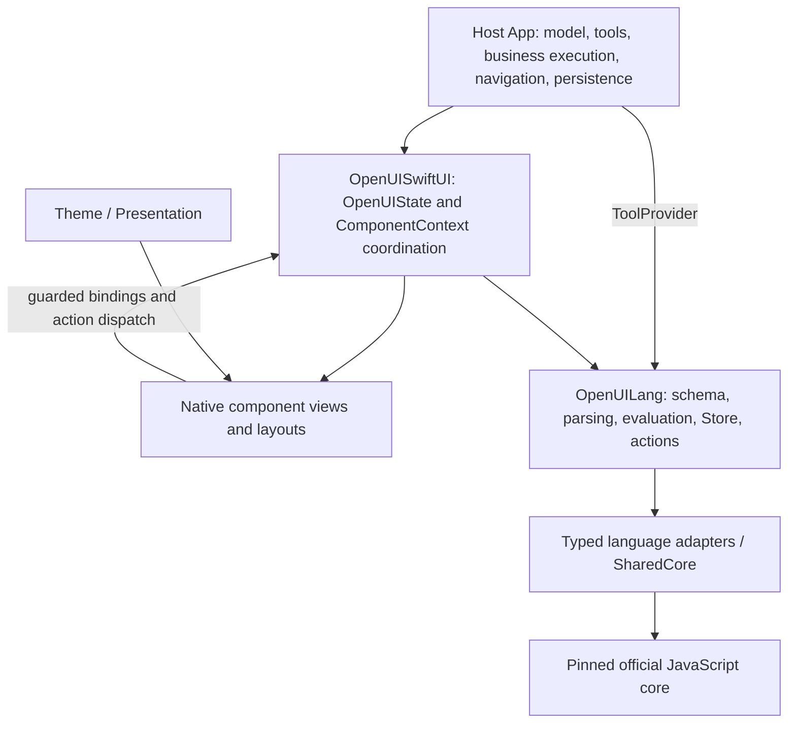

# SwiftUI SDK structure

`OpenUISwiftUI` remains one SwiftPM product and one Swift module. Directories
separate responsibilities; they do not create additional runtime layers.

```text
Sources/OpenUISwiftUI/
  Components/     Native component views and their presentation helpers
  GenUILib/       OpenUI definitions, view bindings, registry assembly and catalog
  Context/        Shared component context and environment scopes
  Theme/          Default tokens, typography, palettes and theme application
  Internal/       Resource/localization helpers, rich-text engine and identity helpers
  Resources/      Bundled data, scripts, licenses and localization files
  Renderer.swift  Public renderer entry point
  RenderNode.swift / RenderValue.swift / QueryView.swift / ErrorBoundary.swift
  OpenUIState.swift / Resources.swift / NativeStringBridge.swift
```

## Responsibilities

- `OpenUILang` owns language parsing, evaluation, schema/prompt generation and
  language state. It has no dependency on SwiftUI or its theme.
- `Theme` defines appearance values and how a subtree receives them. It does
  not inspect the generated document or infer business-specific styling.
- `GenUILib` associates ordered component definitions with native builders.
  The exported schema and prompt describe those definitions.
- `OpenUIState` bridges language state to the application; the resource layer
  owns message-scoped loads. The rendering entry points traverse evaluated
  values and use `Context` for identity and interaction eligibility.
- `Components` implements presentation and interactions in a flat directory.
  A shared presentation helper is not automatically registered as a model-facing
  component. Registrations are assembled under `GenUILib`.

The reference React implementation separates component definitions in
`genui-lib`, shared context/runtime, and component views. Swift keeps those
responsibilities within its native module, using SwiftUI Environment rather than
CSS custom properties. `Components` and `GenUILib` follow that same separation. React-specific hooks
and CSS utilities are not reproduced, and components are not split into
additional SwiftPM packages or targets.

## Theme application

`OpenUITheme` contains optional overrides. `OpenUIThemeValues` contains the
resolved values read by components. The view modifier resolves the selected
mode's defaults with the caller's overrides and injects the result through
SwiftUI Environment. No document inspection or global theme store is involved.

```swift
var light = OpenUITheme()
light.spaceM = 16
light.textBodyDefault = OpenUIFont(size: 17)
renderer.openUITheme(mode: .system, lightTheme: light, darkTheme: dark)
```

A missing dark override set reuses the light overrides. A newly declared nested
scope starts from SDK defaults, matching the pinned React ThemeProvider; it does
not merge the parent's overrides. Unmodified descendants inherit their nearest
scope. Typography roles are complete independent values, not getter/setter
snapshots of other roles. The default native fonts and reading scale are retained.

`OpenUIPresentation` is a separate environment value for native-only media
metrics, hit targets, chart axes and motion. Theme replacement does not change
it. Both values are available to native and application-defined components.

## Component style selection

The OpenUI Lang definitions and positional parameters are unchanged. Size and
gap variants select existing token roles; for example `gap="m"` reads `spaceM`,
and `gap="none"` is always zero. Schema and prompt generation do not depend on
theme overrides.

| Component presentation | Theme role |
| --- | --- |
| TextContent default / small / large | textBodyDefault / textBodySm / textBodyLg |
| TextContent small-heavy / large-heavy | textBodySmHeavy / textBodyLgHeavy |
| Text sm or md / xs / lg | textBodyDefault / textBodySm / textBodyLg |
| BoldText sm or md / xs / lg | textBodyDefaultHeavy / textBodySmHeavy / textBodyLgHeavy |
| ImageTextLarge title | textBodyDefaultHeavy |
| Markdown strong text | textBodyDefaultHeavy weight, keeping surrounding size |
| Markdown headings | textHeadingMd / textHeadingSm / textHeadingXs |

The supported token names and meanings follow React's Theme. Swift uses `Color`,
point values and `OpenUIFont`, rather than a CSS parser. System fonts, contrast
fallback, width-derived cover cropping, native chart colors and platform motion
remain deliberate native presentation choices. React-only chat-shell tokens and
unused CSS capabilities are not advertised as implemented native controls.

## 2026-11-02 boundary review: current ownership before changes

Baseline: published `0.1.1-rc.4` / `deea2a310031a8e9f2b8357e3009b6664fc0ddc5`.
This review keeps both existing modules and their package dependency direction.



| State / concern | Authoritative owner | Local or derived state |
| --- | --- | --- |
| Source, root AST, semantic values and action plans | OpenUILang runtime and Store | OpenUIState publishes evaluated render/query projections |
| Source replacement and in-flight callback eligibility | OpenUIState source/presentation revisions | ComponentContext captures its presentation revision |
| Standard field writes and language actions | ComponentContext -> OpenUIState -> language Store/action runtime | Focus, hover, open/closed UI and activation intent remain native |
| Editable table data | Language form/Store after commit | NativeTableDraft owns only the unsubmitted draft and baseline |
| Validation | Language rules and scoped NativeFormValidation registration | Per-field errors and first-invalid focus are UI coordination |
| Display resources | Message-scoped OpenUIResourceStore and loader | View requests and loading placeholders are presentation state |
| Theme and platform geometry | OpenUIThemeValues / OpenUIPresentation | Views choose existing roles; language schemas are theme-independent |
| Real model/tool execution and persistent product state | Host App | SDK emits typed requests/events and receives tool results |

The JavaScript-backed parser, evaluator, Store and query-manager facades inside
OpenUILang are the platform adapter implementation; their JS handles are private.
SharedCore owns the language realm, synchronization, budget and conversion.
No UI component imports this implementation or receives a JSValue.
UI rich-text and syntax-highlighting realms are separate presentation adapters:
they do not evaluate OpenUI Lang or run model-supplied JavaScript.

### Confirmed changes to make, without rebuilding compliant parts

1. Move the existing syntax-highlighting bridge out of NativeCodeBlock into the
   UI module's internal presentation adapters. Keep token output typed and lossless.
2. Route editable-table commit and dispatch through ComponentContext, preserving
   its exact form payload while applying presentation revision, readiness and
   activation checks consistently with other controls.
3. Use the existing presentation hit-target policy for code-copy controls, and
   put syntax colors under the existing theme/palette responsibility.
4. Apply the reviewed read-only list and compact chart presentation corrections.
   Keep language resources, parser, schema shapes and positional signatures fixed.

Existing theme resolution, resource ownership, runtime budgets, query cancellation,
registry assembly and per-component readiness are retained and tested.
The final review records actual dependency removals and regression results below;
directory layout alone is not completion evidence.

### Implemented dependency changes

| Before | After / owner | Regression evidence |
| --- | --- | --- |
| NativeCodeBlock contained JavaScriptCore setup and tokenization details | Internal/NativeCodeSyntax owns the private presentation realm and returns typed lossless tokens | ArchitectureBoundaryTests; existing NativeCodeSyntaxTests |
| NativeEditableTable wrote fields and dispatched through OpenUIState directly | ComponentContext commits the exact table form value and dispatches using its captured source, readiness and activation eligibility | TableDispatchBoundaryTests: exact payload, ready streamed prefix, stale presentation, reading drag, reentrant host reset |
| Code views selected syntax colors and used a fixed 44pt copy target | NativeControlPalette owns syntax hues; the existing presentation hit-target policy sizes copy controls | ReadingRhythmTests code-copy policy test; syntax/source preservation tests |
| Every EntityList value was emphasized and text retained trailing alignment after stacking | Plain values use body roles and leading text; explicit numbers/totals retain emphasis; read-only rows use spaceS | ReadingRhythmTests measured font-role/spacing tests and rendered glyph-edge test |
| SingleStackedBarChart reserved a 100pt plot for a 28pt strip | OpenUIPresentation owns shared strip thickness; plot sizing uses it plus theme padding and platform hit target | ReadingRhythmTests compact plot/ordinary axis plot; fixed native B04 replay |

The syntax bridge extraction removes a source-file dependency on JSC details;
it does not claim that OpenUISwiftUI no longer uses JavaScriptCore. Rich text and
syntax highlighting remain private presentation adapters inside this same module.
The language realm and UI presentation realms are independent.

### Existing ownership retained

- OpenUILang, its official generated core, runtime budgets, parser/evaluator,
  typed native adapters and cancellation mechanisms are unchanged.
- Component definitions, registry assembly, positional contracts and parameter
  enums are unchanged. No SwiftPM product, target or package is added.
- OpenUIState remains the UI projection/lifecycle owner; components may observe
  its read-only values, but standard component mutations/dispatch go through
  their context. NativeTableDraft remains an unsubmitted editing draft.
- A fresh answer uses a fresh OpenUIState or reset. Editing source within the same
  state can intentionally preserve committed values; stale presentation callbacks
  still cannot dispatch after the source revision changes.
- Existing typography roles, ContextCard summary semantics and MarkdownUI block
  margin combination are retained. No global redefinition of font sizes or
  removal of paragraph margins is justified by this review.
- Only one new internal geometry value is introduced: the existing 28pt strip
  thickness, shared by drawing and intrinsic sizing. Algorithmic measurements are
  not mechanically turned into tokens.

### Acceptance matrix and measured result

| Requested change / boundary | Evidence |
| --- | --- |
| Theme changes do not require parser, schema or model output changes | ThemeArchitectureTests / ThemeOverrideTests and unchanged language/registration sources |
| Table/list layout can be repaired independently of the language core | ReadingRhythmTests; no OpenUILang or generated-core diff |
| An ordinary component registers without changing grammar | Existing ComponentLibraryTests registration and named-slot extension tests |
| Backend changes do not require replacing native components | Injected ToolProvider Query/Mutation tests and ProtocolInteractionTests |
| Core adaptation/resources/compatibility are the upgrade seam | Existing resource/bridge/budget tests and pinned-core differential suites; no core upgrade is performed in this patch |
| Standard actions share guarded dispatch; old callbacks cannot affect a new answer | ArchitectureBoundaryTests, TableDispatchBoundaryTests and existing lifecycle/readiness tests |
| UI issues replay without asking a model again | Same-source C04/B04/two-day native captures using the isolated candidate host |

Validation on 2026-11-02:

- 39 focused baseline tests passed.
- Four new measured presentation tests failed on rc.4 and passed after the patch.
- Final root-package run: 339 XCTest tests passed, zero failures.
- Official conformance: 59 cases passed, zero skipped; pinned TypeScript
  differential: 306/306; identity/UTF-16/RegExp differential: 1906 reference cases.
  These case counts are not added to the XCTest test count.
- One existing step-marker test fixture still selected the pre-rc.4 regular role.
  Its fixture now selects textBodySmHeavy, matching the unchanged production role.
- The iOS Simulator candidate host builds successfully. C04, B04 and the two-day
  scene exported complete with no language diagnostics; entry and per-turn Lang
  source hashes match the existing rc.4 inputs.
- C04 content height: 2528.33 -> 2472.33pt. B04: 3388 -> 3284pt.
  These describe the measured layout change, not a universal density target.
- 96 language/registration/catalog/manifest files match the base commit byte for
  byte. The original dirty SDK checkout's tracked diff and untracked path list
  remain unchanged.

Raw logs and native captures are recorded by the Case Lab review workspace at
`/Users/finn/Documents/research/openui-case-lab/work/sdk-boundary-20261102/`.
The candidate has a separate simulator bundle, dev.openui.boundary-review.
The published rc.4 tag and Case Lab's remote release pin are unchanged.

This closes the observed boundary crossings and presentation regressions in this
patch. It does not establish behavior for every future core version, backend or
unexercised device/interaction. Residual content-level repetition remains an
authoring concern; the SDK does not rewrite the supplied response.

## Follow-up correctness and compatibility repair

The preceding boundary review did not prove every language/renderer behavior.
Independent regression probes subsequently exposed ignored edits to compiled
schema projections, fractional-origin slider rounding and collapsed regex
exhaustion diagnostics. The compatibility repair keeps the same module boundary:

- OpenUILang SchemaDocument synchronizes compatible projection edits into the
  retained full schema document. Library.extend and recompilation remain the
  preferred structural authoring path; no public setter is silently removed.
- NativeTableEditingState owns only a retryable draft and local save attempt.
  ComponentContext and OpenUIState still own revision/readiness checks and
  event dispatch. The local delivery receipt precedes a host callback and is
  independent of the returned event list; it is not a remote persistence receipt.
- Store publication does not commit a rejected draft. Source replacement resets
  that draft lifetime. Coordinator tests and a mounted NSHostingView regression
  cover the real source onChange path, retries and duplicate saves.
- Slider uses minimum and step precision in a single value-construction path.
  Its non-divisible endpoint and continuous numeric-draft behaviors remain
  explicit, separate from the repaired fractional-origin defect.
- Pattern exhaustion blocks form submission with a distinct message, preserving
  ordinary mismatch and invalid-pattern behavior. Lang wire error codes remain
  unchanged. protocolSource preserves omitted official diagnostic sources while
  keeping the native API's legacy nonoptional source fallback.

The maintained inventory and strict pinned oracle are documented in
`packages/swift-lang/COMPATIBILITY.md`. Parser snapshots retain every protocol
field and ordering. Native action traces execute against the pinned official
framework callback, with controlled success, failure and cancellation. Resource
limits, serializer fixes and the unproven deep-transport domain are recorded
separately; passing these cases is not a claim of universal equivalence.
